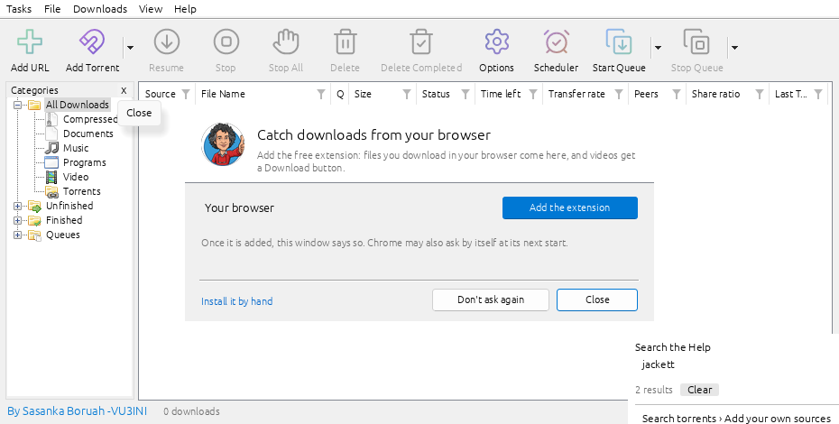
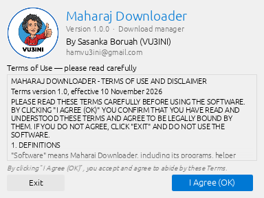
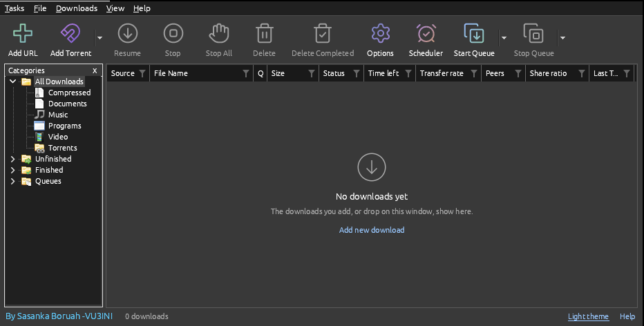
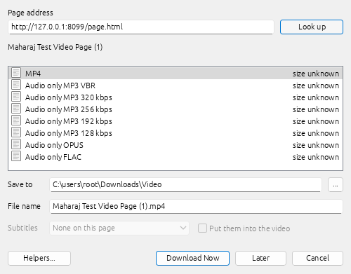
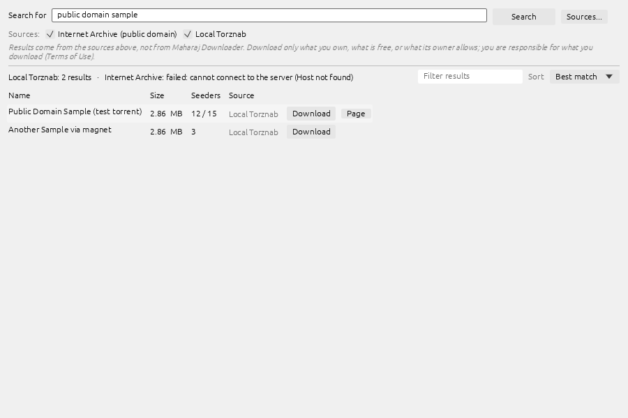
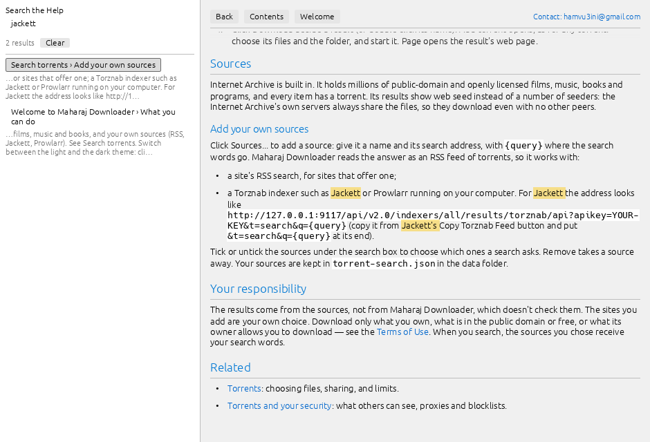
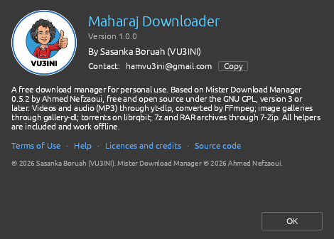
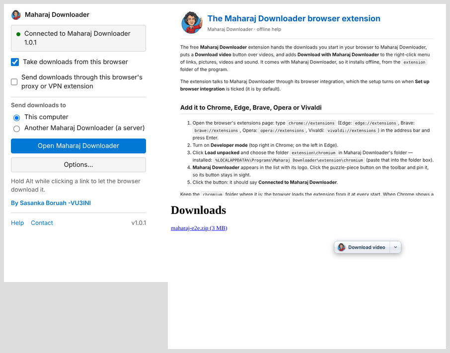

  

<h1 align="center">Maharaj Downloader</h1>

  A free download manager for Windows 10 and 11 — files, videos and MP3s, torrents and image galleries. 
  Everything it needs is included, so it installs and runs offline. 
  <b>By Sasanka Boruah (VU3INI)</b> · <a href="mailto:hamvu3ini@gmail.com">hamvu3ini@gmail.com</a>

  <a href="../../releases/latest"><b>⬇ Download the latest version</b></a>

  

## What it does

- **Fast, resumable downloads** — each file is split over several connections, broken downloads continue where they stopped, and a scheduler and queues can download overnight.
- **Videos and MP3s** from YouTube and well over a thousand other sites, with [yt-dlp](https://github.com/yt-dlp/yt-dlp) and FFmpeg included: pick a quality, or *Audio only MP3* at 128–320 kbps, Opus or FLAC.
- **Torrent search and torrents** — search the Internet Archive's public-domain films, music and books, or your own RSS / Jackett / Prowlarr sources, and download with the built-in torrent client.
- **Browser extension** for Chrome, Edge, Brave, Opera, Vivaldi and Firefox: clicked downloads come to Maharaj Downloader, and videos get a *Download video* button.
- **Light and dark themes**, one click away at the bottom right.
- **Searchable Help** built in (F1), working offline.
- **86 interface languages**, image galleries (gallery-dl), 7z/RAR extraction (7-Zip), a portable mode for USB sticks.

| | |
|---|---|
|  |  |
|  |  |
|  |  |

## Install

1. Open the [latest release](../../releases/latest) and download **`Maharaj_Downloader_vX.Y.Z.zip`**.
2. Extract it and run **`Maharaj_Downloader_Setup_vX.Y.Z.exe`**. No administrator rights are needed.
3. If Windows says *"Windows protected your PC"*, click **More info → Run anyway** (the program isn't code-signed).
4. Accept the Terms of Use when Maharaj Downloader starts.

For a **portable copy** (USB stick), run the same setup, choose a folder on the stick and tick **Portable copy**.

### Browser extension

The extension is installed with the program, in its `extension` folder, where `INSTALL.html` shows each step. It is also attached to every release on its own.

- **Chrome, Edge, Brave, Opera, Vivaldi:** extensions page → **Developer mode** → **Load unpacked** → choose `%LOCALAPPDATA%\Programs\Maharaj Downloader\extension\chromium`.
- **Firefox:** `maharaj-downloader-firefox.xpi` (not yet signed by Mozilla: see `INSTALL.html`).

## Terms of Use

Maharaj Downloader is for **personal, non-commercial use only**, and **you alone are responsible** for what you download with it. Download only what you own, what is free, or what its owner allows you to download. The full [Terms of Use](crates/app/assets/brand/terms.txt) are shown, and must be accepted, every time the program starts.

## Licence and credits

Maharaj Downloader is a modified version of **[Mister Download Manager](https://github.com/anefzaoui/misterdownloadmanager)** 0.5.2 by Ahmed Nefzaoui, and like it is free software under the **[GNU General Public License, version 3 or later](LICENSE)**. It comes with no warranty. What was changed is listed in [MAHARAJ-CHANGES.md](MAHARAJ-CHANGES.md); the upstream project's own read-me and change log are kept as [UPSTREAM-README.md](UPSTREAM-README.md) and [UPSTREAM-CHANGELOG.md](UPSTREAM-CHANGELOG.md).

The releases include [yt-dlp](https://github.com/yt-dlp/yt-dlp) (Unlicense), [FFmpeg](https://ffmpeg.org) (LGPL build by [BtbN](https://github.com/BtbN/FFmpeg-Builds)), [gallery-dl](https://github.com/mikf/gallery-dl) (GPL-2.0) and [7-Zip](https://www.7-zip.org) (LGPL + unRAR restriction), each under its own licence; their texts are in the `LICENSES` folder installed with the program. Icons, data and libraries: [ATTRIBUTION.md](ATTRIBUTION.md).

The name "Maharaj Downloader", the VU3INI callsign and logo identify this build and its author and are not licensed under the GPL: if you distribute a modified version, please give it another name and logo.

## Build from source

See [maharaj-build/README.md](maharaj-build/README.md).

## Contact

Questions, suggestions and problems: **hamvu3ini@gmail.com** (in the program: **Help → Report a problem**), or open an issue here.
